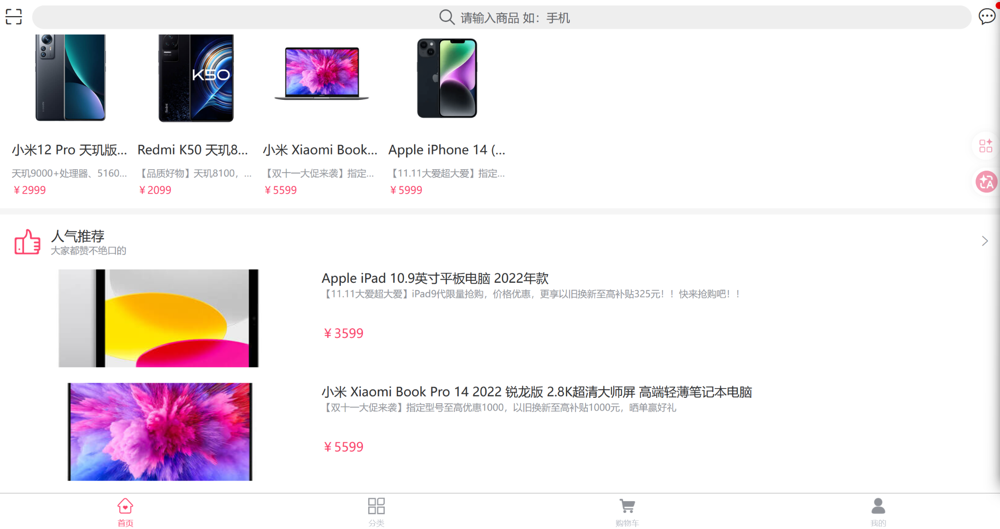
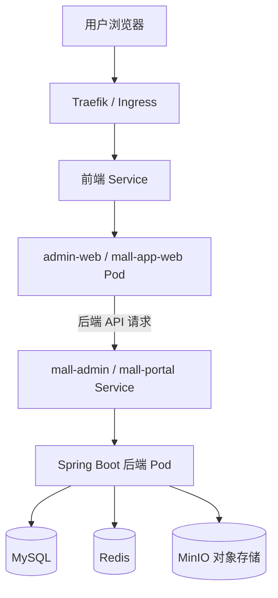
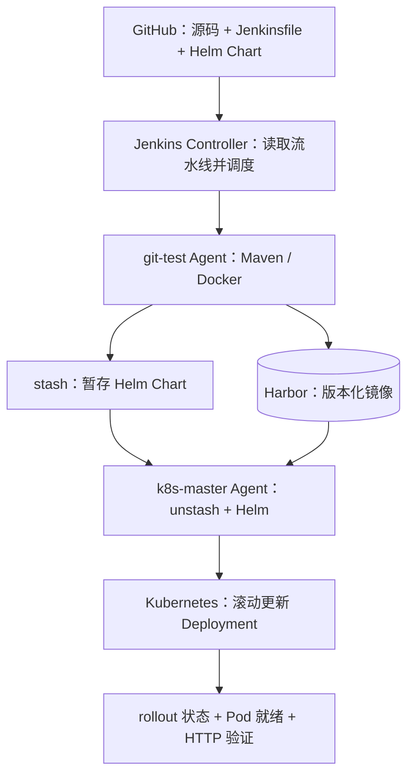
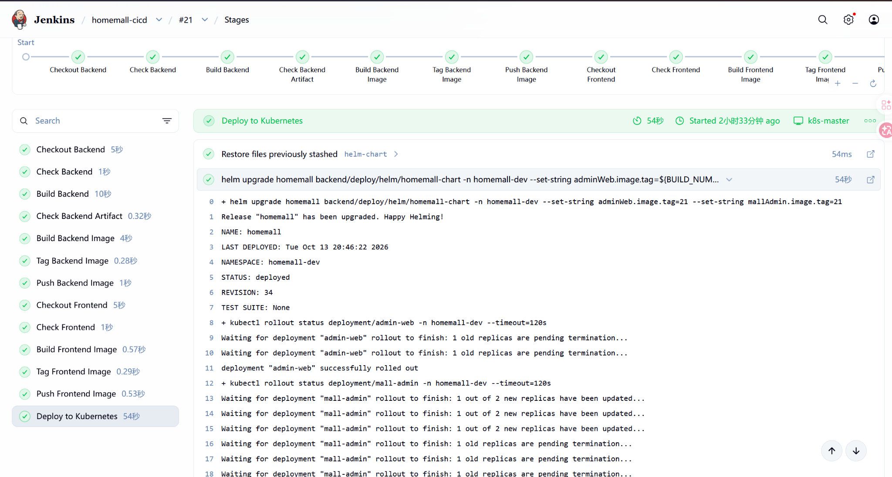
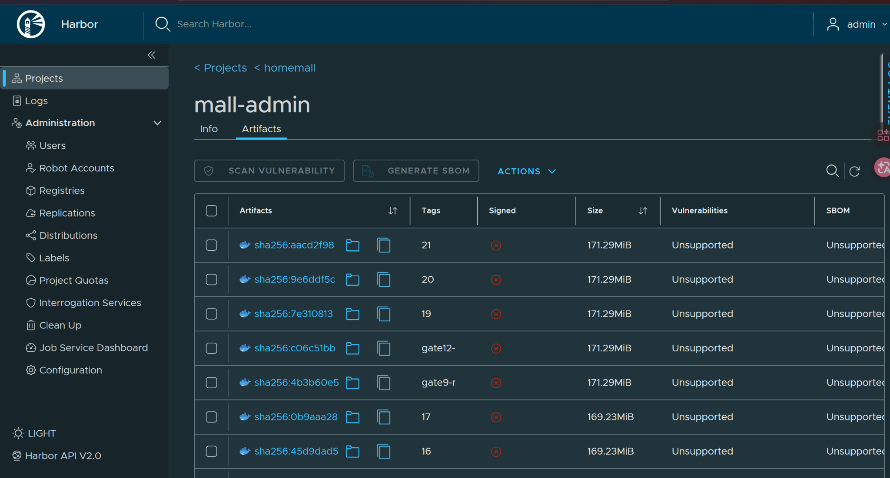
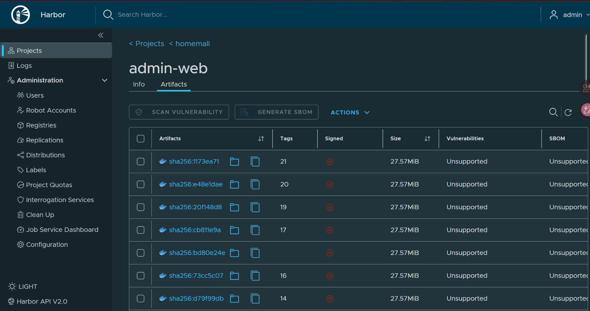
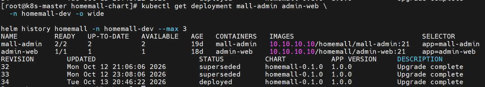

# HomeMall Cloud-Native DevOps

> 基于开源电商项目 [macrozheng/mall](https://github.com/macrozheng/mall) 的 **Kubernetes 云原生部署与 DevOps 工程实践**。
>
> 本仓库侧重展示本人对现有业务系统的**容器化、基础设施部署、Helm 配置管理、Jenkins CI/CD、服务可用性和故障排查**实践；原有电商业务功能并非本人从零开发。

## 1. 项目目标与范围

将已有 Spring Boot 电商系统部署到自建 Kubernetes 集群，并建立从 GitHub 源码到 Harbor 镜像仓库、再到 Helm/Kubernetes 的可验证交付流程。

**本人实践范围**

- 在 PVE 实验环境部署和维护 Kubernetes 集群，使用 Containerd、Flannel、CoreDNS。
- 为管理后台和商城相关组件编写/维护 Dockerfile、Kubernetes 资源和 Helm Chart；使用 Traefik Ingress 暴露 HTTP 服务。
- 为 `mall-admin` 配置多副本、readiness/liveness/startup 探针，验证滚动更新和 Service 访问。
- 在 Jenkins 中配置多 Agent 流水线，完成 Maven 构建、Docker 镜像构建、Harbor 推送、参数化 Helm 部署。
- 使用 Kubernetes Secret/环境变量管理**部分**应用连接凭据，降低在应用配置中直接保存明文密码的风险。
- 接入/部署 Prometheus、Grafana 相关监控组件，开展应用可观测性实践。
- 记录 Git 网络超时、Agent 重复检出、发布配置对比等真实排障案例。

**范围说明**：该仓库并非从零编写电商业务，也不宣称已实现生产级高可用、全量自动回滚或全链路安全审计。数据库、存储与网络依赖需要按照实际环境单独准备。

## 2. 技术栈

| 分类 | 采用的技术/组件 |
| --- | --- |
| 基础环境 | Proxmox VE、Rocky Linux、Linux 网络 |
| 容器与编排 | Docker、Containerd、Kubernetes v1.30、Flannel |
| 流量入口 | Traefik、Ingress、Kubernetes Service、CoreDNS |
| 发布与配置 | Helm Chart、ConfigMap/Secret、Deployment、StatefulSet |
| CI/CD | GitHub、Jenkins Controller + 多 Agent、Maven、Harbor |
| 监控 | Prometheus、Grafana、Spring Boot Actuator / Micrometer |
| 业务依赖 | MySQL、Redis、MinIO；部分业务模块包含其他外部依赖 |

## 3. 系统架构

### 商城前台实际运行效果

基于开源商城完成云原生部署，以下为 2026-10-15
在个人实验环境中验证的商品展示页面。



> 商品页面与原有业务逻辑来自上游开源项目；
> 本项目重点实践容器化部署、CI/CD、Kubernetes 运维及对象存储接入。


**运行时业务访问链路（自上而下）**



> 图为业务访问与核心依赖的概览，不表示所有页面的每个请求都依次经过全部组件，也不表示所有依赖均部署为 Kubernetes Pod。

**CI/CD 发布链路**



📖 更多职责划分与调用过程见 [架构说明](docs/architecture.md)。

### 项目文档导航

- [系统架构说明](docs/architecture.md)
- [部署与验证手册](docs/deployment.md)
- [真实故障排查复盘](docs/troubleshooting.md)

## 4. 关键工程实践

### 4.1 Helm 管理应用

Chart 位于 [`deploy/helm/homemall-chart/`](deploy/helm/homemall-chart/)，通过 `values.yaml` 与 `templates/` 管理组件镜像、端口、副本和运行配置。发布前检查配置差异并进行 `helm upgrade --dry-run=server` 验证。

### 4.2 Jenkins 参数化 CI/CD

流水线位于 [`Jenkinsfile`](Jenkinsfile)：

1. 显式检出后端代码与前端代码；
2. Maven 构建后端、Docker 构建前后端镜像；
3. 使用 Jenkins 构建编号打镜像 Tag 并推送 Harbor；
4. 通过 `stash/unstash` 将 Helm Chart 从构建 Agent 传至部署 Agent；
5. `DEPLOY_TO_K8S=false`（默认）仅执行 CI；手动勾选后才执行 Helm 发布和 Rollout 检查。

通过 `skipDefaultCheckout(true)` 避免 Agent 切换时不必要的自动源码检出。**当前已验证的是手动参数化构建，不代表已接入自动 Webhook。**

### 4.3 配置和凭据处理

- 后端业务配置中的部分数据库、Redis、Druid、RabbitMQ 密码改为环境变量引用。
- 对应 Kubernetes Deployment 通过 `env.valueFrom.secretKeyRef` 引用 Secret。
- 新镜像依赖的变量须先在 Kubernetes 中配置齐全，不能仅凭“源码改成 `${...}`”就直接更新镜像。
- **遗留边界**：旧镜像、Git 历史和外部组件内部账号可能仍有旧凭据；后续应审计并轮换仍有效的密钥。

## 5. 已验证的发布结果

以下为 **2026-10-13 在个人实验环境中的一次实际验证**，不是持续运行保证：

| 检查项 | 结果 |
| --- | --- |
| Jenkins Pipeline | `#21` SUCCESS |
| Jenkinsfile 提交 | `304e4d7` |
| Harbor 镜像版本 | `mall-admin:21`、`admin-web:21` |
| Helm Release | `homemall`，Revision **33 → 34**，状态 `deployed` |
| Kubernetes Deployment | `mall-admin` **2/2**、`admin-web` **1/1** 就绪 |
| 后端 HTTP 检查 | 从 `admin-web` Pod 经 `mall-admin` Service 访问 `/actuator/health`，返回 `status: UP` |
| 浏览器 | 该次发布后访问正常 |

上述记录只证明这次实验环境的构建、部署和基本健康验证通过；还不等于所有业务链路、压力负载及生产故障场景全部通过。

### 实际运行截图

**Jenkins #21：完整 CI/CD 流水线及 Helm 发布结果**



**Harbor：前后端镜像版本**

| mall-admin:21 | admin-web:21 |
| --- | --- |
|  |  |

**Kubernetes：Deployment 状态及 Helm 发布历史**



## 6. 如何查看与验证

> 以下以已具备 Kubernetes、Helm、Harbor、相关 Secret 和业务依赖的实验环境为前提。**不要将项目中的示例地址或镜像仓库 IP 原样用于其他环境。**

```bash
# 查看命名空间中前后端 Deployment 状态
kubectl get deployment mall-admin admin-web -n homemall-dev

# 查询当前实际镜像版本
kubectl get deployment mall-admin admin-web -n homemall-dev \
  -o custom-columns='NAME:.metadata.name,IMAGE:.spec.template.spec.containers[*].image'

# 查看 Helm 发布记录
helm history homemall -n homemall-dev

# 从管理前端容器内，经 Service 查询后端健康状态
kubectl exec -n homemall-dev deployment/admin-web -- \
  wget -qO- http://mall-admin:8080/actuator/health
```

完整环境搭建、Secret 注入、镜像仓库认证与部署步骤应另外以环境文档明确列出；**不应将真实口令写入 README 或提交到仓库**。

## 7. 排障案例与后续优化

- **Jenkins 获取 GitHub 仓库慢/超时**：使用相同用户对比直连和 Mihomo 代理下载，确认通过代理 Git 传输明显改善。
- **切换 k8s-master Agent 后 Git Fetch 失败**：排查到默认 Checkout 与已有 `stash/unstash` 文件传递重复，使用 `skipDefaultCheckout(true)` 处理。
- **Helm 发布前变更审查**：对比运行中 Release 与 GitHub Chart 渲染资源，确认除镜像 Tag 外没有额外非空白文本差异。

后续计划：补充脱敏后的 Jenkins/Harbor/Kubernetes/Grafana 实际截图、整理独立部署手册、继续完善回滚演练与告警验证。

## 8. 原项目与许可说明

- **上游业务项目**：[macrozheng/mall](https://github.com/macrozheng/mall)。本仓库为其 Fork；原项目的 Spring Boot 业务代码、已有模块、文档与资源归其原作者及贡献者。
- 本仓库中的云原生部署、CI/CD、运行配置和实验复盘属于针对上游代码开展的工程实践。具体差异可通过 Git 提交历史查看。
- 保留原项目的 [`LICENSE`](LICENSE) 文件；使用与分发时应遵守原项目许可及相关第三方组件许可。
