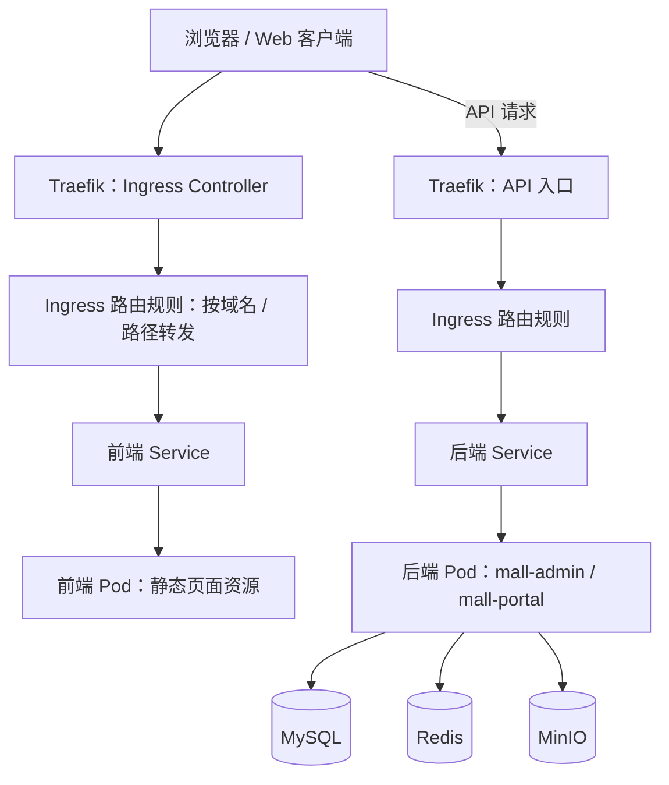
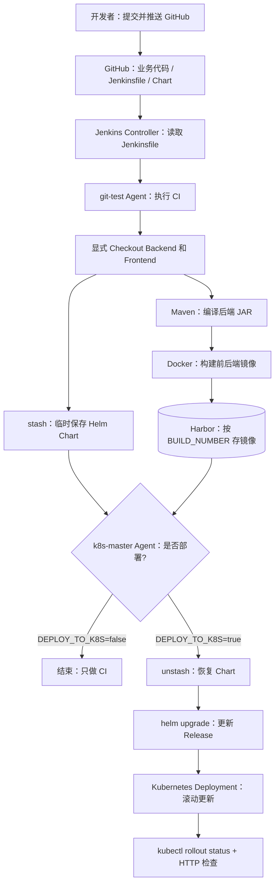
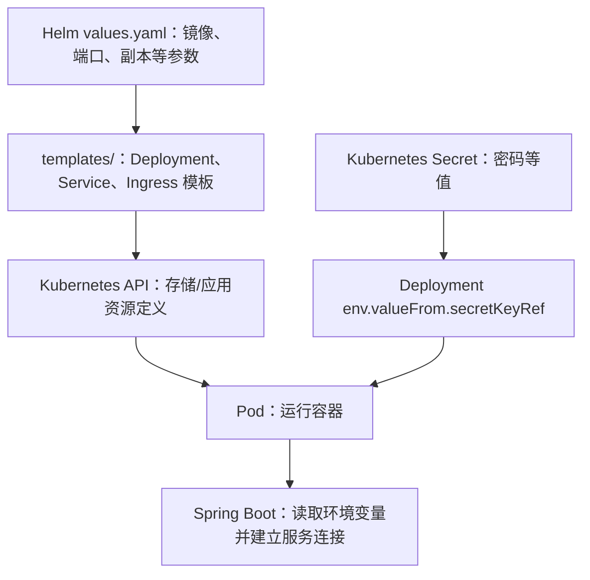

# HomeMall 云原生架构说明

> 这份说明面向项目代码评审、DevOps/SRE 面试和后续实验复盘。画图方向统一采用「上层操作 → 中间组件 → 底层执行」。

## 1. 为什么这样设计

业务代码来自已有开源电商项目，目标是将其部署到容器化运行环境，并建立可追溯、可验证、可人工控制的发布流程。

关键要求：

- **用户访问**：通过 Ingress 和 Service 找到当前可用的 Pod。
- **应用更新**：前后端构建镜像后进入 Harbor，由 Helm 指定版本更新。
- **运行验证**：探针、Rollout、实际 HTTP 请求分层确认。
- **变更安全**：CI 默认不执行 CD；发布前查看 Chart 与 Release 差异；敏感凭据不直接写入应用仓库的新配置。

## 2. 业务请求链路

**注意**：这是逻辑关系，不代表所有客户端请求都经过“前端 Pod 再到后端 Pod”。浏览器获取前端静态文件后，可能独立发起 API 请求；访问路径取决于实际的域名与前端配置。

### 各组件解决的问题

| 组件 | 中文解释 | 不使用会怎样 |
| --- | --- | --- |
| Ingress | 声明外部 HTTP(S) 的域名和路径路由 | 需要通过端口或其他入口分别管理访问 |
| Traefik | 读取 Ingress 并执行真实请求转发的控制器 | 单有 Ingress 规则不会自动处理流量 |
| Service | 为一组后端 Pod 提供相对稳定的服务入口 | Pod IP 变化后客户端直连容易失效 |
| CoreDNS | 根据 Service 名称解析到对应服务地址 | 业务需要手工维护难记、易变的地址 |
| readinessProbe | 判断 Pod 当前是否适合接收服务流量 | 未准备好的 Pod 可能被纳入转发目标 |
| liveness/startupProbe | 检测应用存活与启动过程 | 卡死或启动慢时难以分辨并自动处理 |
| Secret | 向 Pod 提供敏感配置值（需正确配置访问权限） | 凭据更容易出现在普通配置文件中 |

## 3. CI/CD 发布链路

> **触发边界**：当前验证的是 Jenkins 网页手动参数化构建，而非“GitHub Push 就自动触发”的 Webhook。图中“提交并推送”只是更新流水线使用的代码来源，并不意味着自动开始 Jenkins Job。

### Controller 与 Agent 的区别

- **Controller**：读取 Pipeline 定义、分配 Agent、管理构建任务。
- **git-test Agent**：运行 Git、Maven、Docker，构建/推送镜像。
- **k8s-master Agent**：接收 Helm Chart 文件，执行 Helm/Kubectl 操作。
- **Workspace**：不同 Agent 各有工作空间；在 git-test 下载的文件不会天然出现在 k8s-master 的目录。

### stash / unstash 和 Checkout 的关系

1. `Checkout`：将 GitHub 仓库的代码取到 Agent Workspace。
2. `stash`：暂存指定 Workspace 文件，以便当前 Pipeline 后续阶段使用。
3. `unstash`：在另一 Agent 的 Workspace 中恢复这些文件。
4. `skipDefaultCheckout(true)`：禁止 Declarative Pipeline 的**默认**自动 Checkout；明确写出的 `git` 步骤仍会执行。

实际做法：git-test 显式检出业务仓库并暂存 Chart；k8s-master 无需为获得这份 Chart 再自动下载整个仓库。

## 4. 发布配置与运行配置如何衔接

### 安全边界

- `application-prod.yml` 中 `${DB_PASSWORD}` 等只是**读取环境变量**，不负责生成变量。
- Deployment 的 `env` 通过 `secretKeyRef` 把 Secret 条目提供给容器。
- Secret 不会因为应用使用环境变量而自动创建。
- 修改 Secret 后，已经启动的 Pod 通常不会自动更新由环境变量注入的值，需评估滚动重启与业务影响。
- 已经打包在旧镜像或提交到 Git 历史的旧密码，不会因后续外置而消失；需要审计并轮换。

## 5. 这次已证实的结果（2026-10-13）

| 层级 | 证据 |
| --- | --- |
| CI | Jenkins `#21` 构建 SUCCESS |
| 镜像 | Deployment 使用 `mall-admin:21`、`admin-web:21` |
| 发布 | `helm history` 显示 Revision 34 `deployed`，原 Revision 33 `superseded` |
| Kubernetes | `mall-admin` 2/2、`admin-web` 1/1 READY，UP-TO-DATE、AVAILABLE 达预期 |
| Service → Pod | 从 `admin-web` Pod 访问 `http://mall-admin:8080/actuator/health` 返回 `UP` |
| 用户体验 | 发布后浏览器访问正常（本次人工检查） |

## 6. 部署边界与待办

- 此架构图没有覆盖所有未部署或未验证的上游微服务、消息队列、搜索等组件。
- Helm Chart 中含有环境相关的服务地址、Secret 引用、镜像仓库地址。复现前需替换为本地实际设置。
- README 和图表不应暴露生产密码、私钥、Token 或公网管理凭据。
- 建议后续添加：脱敏的实际截图、部署前提清单、手动回滚演练、Prometheus 告警验证和单独的故障复盘文档。
